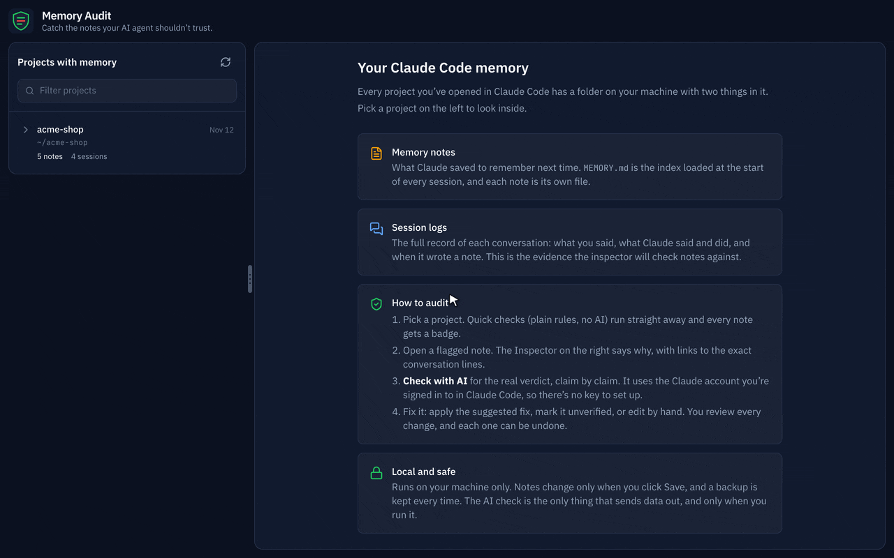

<p align="center">
  
</p>

<h1 align="center">Memory Audit</h1>

<p align="center"><b>Find the notes your AI agent shouldn't trust.</b></p>

<p align="center">
  <a href="https://www.npmjs.com/package/memory-audit"></a>
  
  
  <a href="LICENSE"></a>
</p>

<p align="center">
  
</p>

<p align="center"><sub>The demo uses a made-up project. Your own notes and logs never leave your machine unless you run an AI check.</sub></p>

Claude Code keeps long-term memory as small Markdown notes in `~/.claude/projects/<project>/memory/`. Every new session loads them and treats them as true. Some aren't: the agent guessed, misunderstood, or the facts changed later. Nothing checks them.

Memory Audit checks each note against your own session logs, shows the evidence line by line, and helps you fix what's wrong. It runs on your machine, as a web app or right inside Claude Code.

```bash
npx memory-audit
```

This opens http://127.0.0.1:3210. You need **Node 20.9 or newer**.

---

## 💡 Why this exists

Anthropic's engineering post **[The components of agent memory](https://www.anthropic.com/research/components-of-agent-memory)** (Nov 6, 2026) names the open problems with agent memory: notes go stale, and a wrong note gets trusted by every later session. In one of its examples, a later session relied on a note that said a task was done when it wasn't.

Memory Audit is a practical answer for Claude Code users: an audit you can run any time, which compares what the agent *remembers* with what was actually *said*.

---

## ✨ Features

### 🗂️ Browse everything

Every Claude Code project, with its memory notes and the full conversation logs. **Written in** on a note links straight to the conversation that wrote it.

### ⚡ Quick checks · *no AI, about a second*

Plain rules that run on your machine. They don't judge whether a note is true; they spot the warning signs that tell you which notes deserve a closer look. Each note gets a badge:

| Badge | What it means |
|---|---|
| 🚫 **Not loaded** | The note isn't listed in `MEMORY.md`, so new sessions never see it. Also catches broken links in the index, and an index longer than the 200 lines Claude Code loads. |
| 🕳️ **No evidence left** | The conversation that wrote the note has been deleted. Claude Code removes logs after 30 days, but notes stay forever. |
| ⏳ **Old** | The note hasn't changed in 30+ days, but newer conversations have happened since. |
| 🔗 **Broken references** | The note mentions files or folders that no longer exist. |
| ↩️ **Possibly corrected** | After the note was written, you said something like "no longer", "that's wrong" or "switched to" about the same topic. |
| 🧹 **Hygiene** | Missing name or description, empty notes, near-duplicates. |

### 🤖 AI check · *the verdict*

Claude reads the note and the related parts of your logs, then rates each claim as **supported**, **out of date**, **wrong** or **unverified**. Every claim cites a session and line, and any citation that doesn't exist is dropped. You see exactly what will be sent before it runs. Results are saved, so you never pay twice.

### 🛠️ Fix it safely

Apply the AI's suggested fix, mark the note as unverified, or edit it by hand. You always review a diff first. Every save makes a backup in `~/.memory-audit/backups`, and **Undo** restores it.

### 🧩 Or never leave Claude Code

The same audit ships as a Claude Code plugin. Ask *"are my memory notes still right?"* in any session. [More below.](#-claude-code-plugin)

---

## 🚀 Quick start

```bash
npx memory-audit              # open the web app
npx memory-audit --readonly   # look, but never write
npx memory-audit check        # quick checks for this folder's project, in the terminal
```

If Claude Code is installed and you're signed in, the AI check works straight away: no API key, nothing to configure.

---

## 🧩 Claude Code plugin

Use whichever you prefer. The plugin and the web app share the same checks, saved results and backups: a note checked in chat shows its verdict in the web app, and a fix made in chat can be undone from either one.

**Install** by typing this at the Claude Code prompt, then answer `y` to add the marketplace and pick a scope:

```
/plugin install memory-audit --marketplace utsavk1993/memory-audit
```

On an older Claude Code without `--marketplace`, use two steps:

```
/plugin marketplace add utsavk1993/memory-audit
/plugin install memory-audit@memory-audit
```

| Command | What it does |
|---|---|
| `/memory-audit:audit` | Quick checks for the current project. Lists flagged notes and offers the one-step index fixes. |
| `/memory-audit:check <note>` | AI check in the chat. Claude reads the note plus the related log excerpts, rates each claim with cited log lines, saves the verdict, and shows a fix as a diff. Writes only after you say yes. |
| `/memory-audit:audit ui` | Starts the web app in the background and prints its link. |

You can also just ask, for example *"is my deploy note still true?"*, and Claude picks the right one.

> 🔒 **What the in-chat check sends:** nothing goes to a new party. Claude in your current session does the check, so the note and its log excerpts go to Anthropic, which already received them, and they also end up in this session's own log. It uses your normal Claude Code usage.

**Same commands in a terminal:** `npx memory-audit check`, `evidence <note>`, `apply <note> <file> --sha <hash>`, `undo <note>`, `add-to-index <note>`, `remove-broken-links`, `ui`. Run `npx memory-audit help` for the full list.

To try the plugin from a checkout without installing: `claude --plugin-dir ./plugin`.

---

## 🔑 AI check setup

The AI check is the only feature that sends data off your machine, and it only runs when you click it.

### ✅ Default: your Claude Code account

If Claude Code is installed and you're signed in, there's nothing to set up and no API key. The app runs `claude -p` in a locked-down mode: no tools, no file access, no plugins, hooks or MCP servers, an empty working folder, and no session log saved. Claude only sees the note plus the related log excerpts (at most about 40k tokens). Those excerpts go to Anthropic, which already received them when the conversations happened. Usage counts toward your Claude plan.

### 🔁 Optional: API keys

To use an API key instead (or if Claude Code isn't installed), set one of these and pick it with `MEMORY_AUDIT_PROVIDER`:

```bash
export MEMORY_AUDIT_PROVIDER=anthropic ANTHROPIC_API_KEY=sk-ant-...   # Claude (default model claude-opus-5-5)
# or
export MEMORY_AUDIT_PROVIDER=nvidia NVIDIA_API_KEY=nvapi-...          # NVIDIA (default model nvidia/nemotron-3-super-120b-a12b)
npx memory-audit
```

Without `MEMORY_AUDIT_PROVIDER`, the app uses Claude Code whenever it's installed, even if a key is set.

When running from source, you can put the key in `.env.local` instead. `MEMORY_AUDIT_PROVIDER` can be `claude-code` (the default when installed), `anthropic` or `nvidia`. NVIDIA is a third party that hasn't seen your logs before, so the app warns you before sending to it.

---

## 🛡️ Safety

- 🏠 **Local only.** The server binds to `127.0.0.1` and rejects requests whose Host isn't local, which blocks DNS rebinding.
- ✋ **No silent writes.** Endpoints that write files or spend money only accept requests from the app's own page: same origin plus a custom header. A write is refused if the note changed on disk since you opened it.
- 📦 **Contained.** It can only read inside the projects folder and only write `.md` files in a project's `memory/` folder.
- 🖼️ **No framing.** Pages send `X-Frame-Options: DENY`, so another site can't trick you into clicking through a hidden frame.
- 👀 **Read-only mode.** `npx memory-audit --readonly` disables all writes.

Found a security problem? Please report it privately; see [SECURITY.md](SECURITY.md).

---

## ⚙️ Options

| Flag / variable | Default | What it does |
|---|---|---|
| `--port <n>` | `3210` | Port (or set `PORT`) |
| `--no-open` | | Don't open the browser |
| `--readonly` | | Never write to memory |
| `--version` | | Print the version |
| `ANTHROPIC_API_KEY` | | AI check with Claude |
| `NVIDIA_API_KEY` | | AI check with NVIDIA |
| `MEMORY_AUDIT_PROVIDER` | `claude-code` if installed | `claude-code`, `anthropic` or `nvidia` |
| `MEMORY_AUDIT_CLAUDE_MODEL` | your Claude Code default | Model for the Claude Code provider, e.g. `opus` |
| `MEMORY_AUDIT_CLAUDE_BIN` | found automatically | Path to the `claude` command |
| `MEMORY_AUDIT_MODEL` | `claude-opus-5-5` | Claude model for the `anthropic` provider |
| `MEMORY_AUDIT_NVIDIA_MODEL` | `nvidia/nemotron-3-super-120b-a12b` | NVIDIA model |
| `MEMORY_AUDIT_CLAUDE_DIR` | `~/.claude/projects` | Where to read projects from (follows `CLAUDE_CONFIG_DIR` if you set it for Claude Code) |
| `MEMORY_AUDIT_BACKUP_DIR` | `~/.memory-audit/backups` | Where backups go |
| `MEMORY_AUDIT_DATA_DIR` | `~/.memory-audit/results` | Where AI results are cached |
| `MEMORY_AUDIT_APP_DIR` | | For the plugin's `ui` command: a Memory Audit checkout to start the web app from |

---

## 🛠️ Tech stack

| Layer | Technology | Used for |
|---|---|---|
| 🖥️ App | **Next.js 16** (App Router), **React 19**, **TypeScript** | The web app and its local API routes |
| 🎨 Styling | **Tailwind CSS 4**, **Lucide** icons | The interface, light and dark |
| 📝 Notes | **react-markdown** + **remark-gfm** | Rendering memory notes |
| 🤖 AI | **Claude Code CLI** (`claude -p`), **Anthropic SDK**, NVIDIA's OpenAI-compatible API | The AI check, through your Claude Code login or an API key |
| ✅ Validation | **Zod** | Checking the AI's answer and its citations |
| 🧩 Plugin | **Claude Code plugin** (skills) + a CLI bundled with **esbuild** | Running the audit inside Claude Code |
| 💾 Storage | Plain files | Backups in `~/.memory-audit/backups`, results in `~/.memory-audit/results`. No database. |

---

## 🧑‍💻 Develop

```bash
npm install
npm run dev            # http://127.0.0.1:3210
npm run typecheck && npm run lint
npm test               # unit tests (vitest)
npm run test:coverage  # same, and fails below 100% coverage
npm run build && npm start
npm run build:plugin   # rebuild plugin/dist/cli.mjs after changing lib/
```

| Path | What it does |
|---|---|
| `lib/claude-code/reader.ts` | Reads projects, notes and session logs. Read-only. |
| `lib/audit/checks.ts` | The quick checks (no AI) |
| `lib/audit/evidence.ts` | Gathers evidence for one note, the audit instructions, citation checking, saved results. Shared by the web app and the plugin. |
| `lib/audit/ai.ts` | The web app's AI check: calls Claude Code, Claude or NVIDIA |
| `lib/audit/writer.ts` | The only code that writes: hash check, backup, restore |
| `lib/cli/main.ts` | Headless CLI. `npm run build:plugin` bundles it into `plugin/dist/cli.mjs`. |
| `plugin/` | The Claude Code plugin: two skills plus the bundled CLI. `.claude-plugin/marketplace.json` lists it. |
| `proxy.ts`, `lib/claude-code/respond.ts` | Localhost and same-origin guards |
| `components/explorer/` | The UI |

---

## 🗺️ Roadmap

- 🤝 **Codex support**, then other agents that keep file-based memory.
- 🌙 **Scheduled audits ("dreaming")**: re-check notes after each session.
- ☁️ **An optional hosted mode** that takes uploaded memory files.

---

## 🤝 Contributing

Contributions are welcome: bug reports, ideas, docs and code.

### 🐛 Issues

- **Found a bug?** [Open an issue](https://github.com/utsavk1993/memory-audit/issues) with what you did, what you expected, and what happened. Include your OS, Node version and `claude --version`.
- **Have an idea?** Open an issue before starting on something big, so we can agree on the approach first.
- 🔒 **Never paste real memory notes or session logs** into an issue or pull request. They hold your private conversations. Make up a small example that shows the problem instead.

### 🔀 Pull requests

1. Fork the repo and create a branch from `main`, named for the change, e.g. `fix/stale-badge` or `docs/plugin-install`.
2. Set it up:

   ```bash
   npm install
   npm run dev            # http://127.0.0.1:3210
   ```

3. Make your change in small, focused commits.
4. Before you push, make sure everything passes:

   ```bash
   npm run typecheck && npm run lint
   npm run test:coverage
   npm run build          # also rebuilds plugin/dist/cli.mjs
   ```

   CI runs the same checks on every pull request, plus CodeQL and a dependency audit. Server code (`lib/`, `app/api/`, `proxy.ts`) must stay at **100% test coverage** (lines, branches, functions and statements), so add tests in `test/` with any change there. `coverage/index.html` shows what's missing.

   If you changed anything in `lib/`, commit the rebuilt `plugin/dist/cli.mjs` too: the plugin installs straight from this repo.
5. Open a pull request against `main`. Say what changed and why, and add a screenshot or short clip for UI changes.

### 🧭 Ground rules

- 🏠 **Keep it local-first.** Nothing may send notes or logs anywhere without the user clicking for it, and a new service that would see the logs for the first time needs a clear warning in the UI.
- ✍️ **All writes go through `lib/audit/writer.ts`**, so every change is backed up, checked against newer edits, and can be undone.
- 🧩 **The web app and the plugin share one engine.** Put audit logic in `lib/`, not in a component or a skill, so both get it.

---

## 📄 License

MIT
